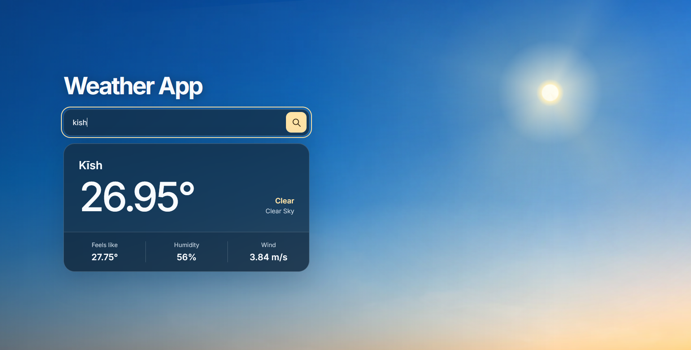
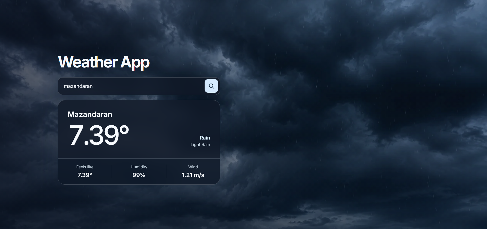
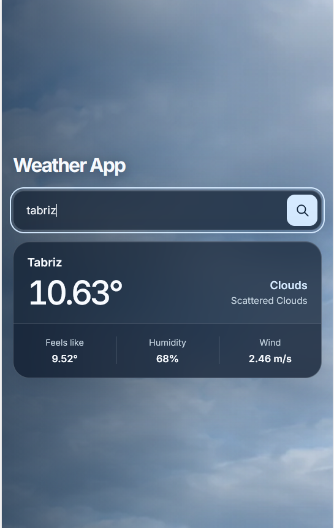

# 🌦️ Weather App

A responsive weather app built with HTML, CSS, and vanilla JavaScript. Search for a city to see its current weather and watch the background change with the conditions.

**Repository name** · `weather-app-js`

## 📖 Description

Weather App is a front-end practice and portfolio project. It fetches current weather data from OpenWeatherMap and displays it in a weather card. The page uses animated sunny, cloudy, and rainy themes on desktop and mobile.

<!-- Add the GitHub Pages demo link here after publishing. -->

## ✨ Features

- Search for current weather by city name.
- View the city name, temperature in °C, feels-like temperature, humidity, wind speed in m/s, and a short weather description.
- Switch the background to sunny for clear skies or rainy for rain, drizzle, and thunderstorms. The cloudy theme is the default.
- See animated clouds, sunlight, and rain, with animations disabled when the device requests reduced motion.
- See loading feedback while a request is in progress and clear messages for a city that cannot be found, an invalid API key, or a failed request.
- Use the app on desktop and mobile with a responsive layout.

## 🛠️ Technologies

- HTML5
- CSS3 with Flexbox, CSS Grid, custom properties, media queries, and keyframe animations
- Vanilla JavaScript with `fetch`, `async/await`, and DOM manipulation
- OpenWeatherMap Current Weather API
- Inter via Google Fonts

## 📸 Preview

Add the four PNG files below to the `screenshots/` folder using these filenames. The images will appear here when those files are committed.

### Desktop

| Sunny                                                | Cloudy                                                 | Rainy                                                |
| ---------------------------------------------------- | ------------------------------------------------------ | ---------------------------------------------------- |
|  |  |  |

### Mobile

| Rainy                                                       |
| ----------------------------------------------------------- |
|  |

## 📁 Project Structure

```text
weather-app-js/
├── assets/
│   ├── cloud.webp
│   ├── rain.webp
│   ├── sun.webp
│   ├── drops-high.png
│   └── drops-low.png
├── screenshots/
│   ├── desktop-sunny.png
│   ├── desktop-cloudy.png
│   ├── desktop-rainy.png
│   └── mobile-rainy.png
├── index.html
├── style.css
├── script.js
└── README.md
```

## 🚀 How to Run

1. Download or clone the `weather-app-js` repository.
2. Get an API key from OpenWeatherMap and set `API_KEY` in your local copy of `script.js` for testing. Keep your personal key out of commits. A key used by a browser-only app is visible to anyone who opens the deployed page.
3. Open the project with the VS Code Live Server extension, or run the following command from the project folder.

   ```bash
   python -m http.server 8000
   ```

   If you use the command, open `http://localhost:8000` in your browser.

4. Enter a city name and submit the form to see its current weather.

## 🎯 Learning Goals

- Fetch and parse JSON from an external API with `fetch` and `async/await`.
- Handle failed HTTP responses and network errors with `try/catch`.
- Update the DOM with values from nested objects and arrays in the API response.
- Handle form submissions and manage loading feedback.
- Apply CSS themes based on API data using `classList`.
- Build responsive layouts and respect reduced-motion preferences.

## 👩‍💻 Author

**Anahita Valipour**  
[GitHub](https://github.com/anahita-valipour)
